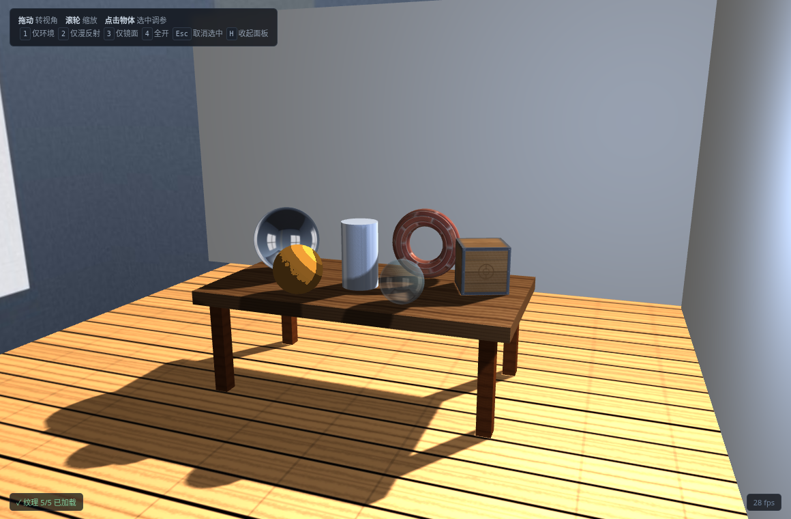
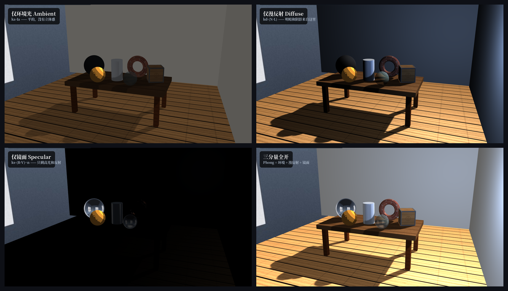
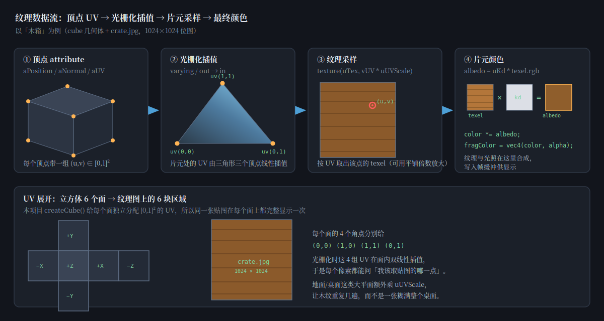
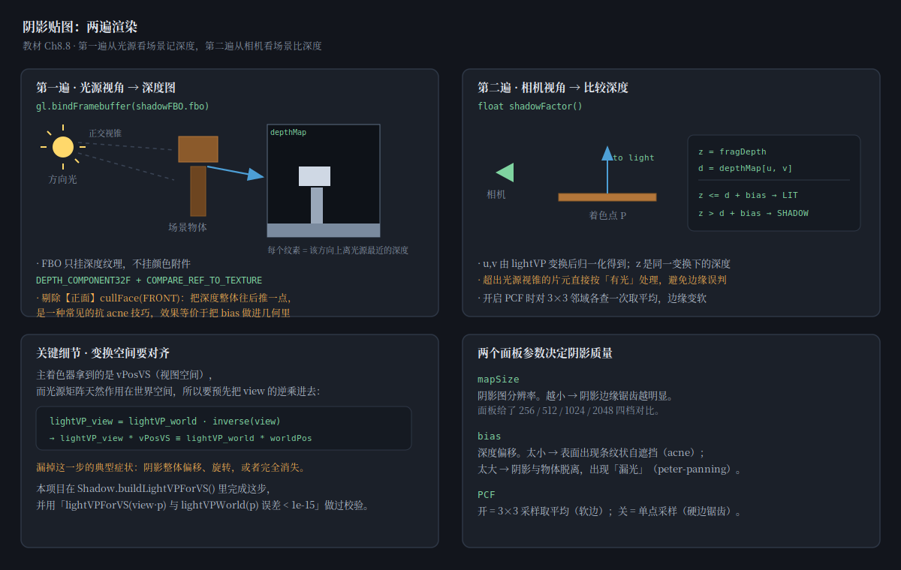
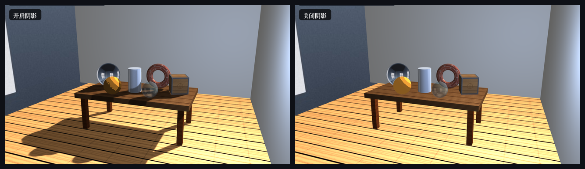
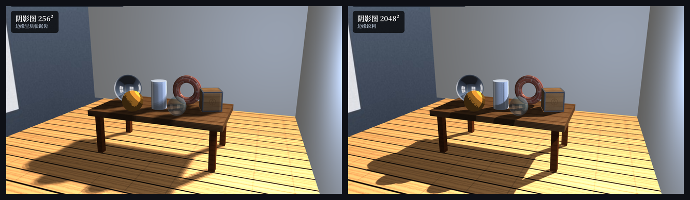
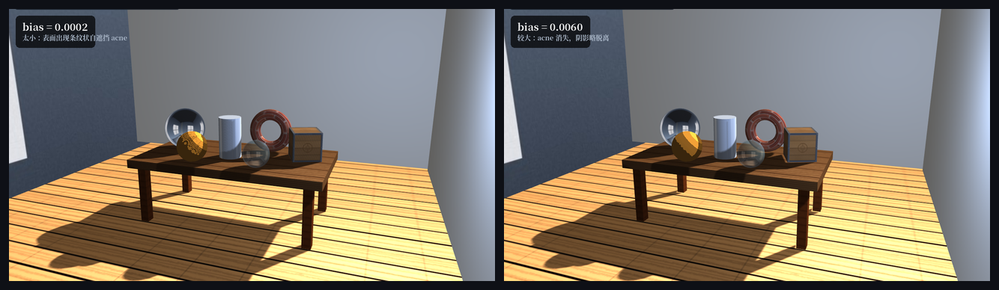
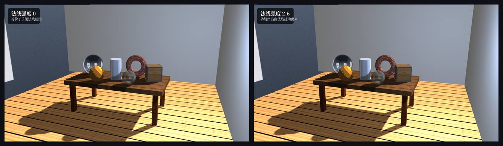
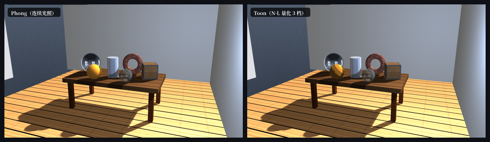

# AP3 · 光照与纹理场景

WebGL 2.0 手写 Phong 着色器 + 普通纹理 + 环境贴图 + 阴影贴图 + 拾取调参。

**在线看** → https://zjy-king.github.io/webgl_zjy/AP3/



---

## 怎么跑

双击 `index.html` 会因为跨域限制读不到纹理，需要起本地服务器：

```bash
python3 -m http.server 8000
# 打开 http://localhost:8000
```

或者直接看上面那个在线链接。

---

## 操作

| 操作 | 效果 |
| --- | --- |
| 拖动 / 滚轮 | 转视角 / 缩放 |
| 左键点物体 | 选中，右侧面板切成该物体的材质参数 |
| `Esc` | 取消选中 |
| `1` `2` `3` `4` | 仅环境 / 仅漫反射 / 仅镜面 / 全开 |
| `H` | 收起面板 |

---

## 目录

```
AP3/
├── index.html          页面骨架 + 面板 HTML
├── js/
│   ├── shaders.js      全部 GLSL（主着色器 / 深度 / 拾取 / 描边 / 天空盒）
│   ├── scene.js        几何生成器 + 场景与材质数据
│   ├── gl.js           WebGL 薄封装（编译、VAO、纹理、FBO、uniform）
│   ├── shadow.js       阴影贴图
│   ├── picking.js      颜色编码拾取
│   ├── ui.js           右侧控制面板
│   └── main.js         装配 + 渲染主循环 + 交互
├── Common/             教材配套 MV.js / utility.js
├── textures/           5 张贴图 + 6 面 cubemap（全部程序化生成）
└── docs/img/           README 用的图
```

---

## 场景

房间 14×9×16。桌面 6 个可拾取物体，加上地面、两面墙、四条桌腿，共 14 个物体。

| 物体 | 用来说明什么 |
| --- | --- |
| 镜面球 | 环境贴图（反射率 0.92） |
| 纹理方块 | 普通位图纹理 |
| 金属圆柱 | 强镜面高光，n = 120 |
| 法线贴图环 | E1 法线贴图 |
| 玻璃球 | E2 透明混合 |
| 卡通球 | E3 Toon 着色 |

两盏灯：方向光（主光，投射阴影）+ 点光源（补光，带衰减）。

---

## 一、Phong

```
I = ka·Ia  +  Σ kd·Il·(N·L)  +  Σ ks·Il·(R·V)^n
     环境          漫反射              镜面
```

三个系数都是 uniform，面板实时可调。三分量各有独立开关：

```glsl
if(uUseAmbient  > 0.5) color += ambient * mix(0.72, 1.0, shadow);
if(uUseDiffuse  > 0.5) color += (diffuse / kdSafe) * lit;
if(uUseSpecular > 0.5) color += (specular / kdSafe) * lit;
color *= albedo;   // 反照率最后统一乘一次
```

> 坑：`diffuse` 里已含 `uKd`，若最后再乘 `albedo = uKd * texel` 就成了 `kd² × 纹理`，
> 浅色材质会被推爆成白块。所以先按 kd 归一，累加完再统一乘一次。



| 组合 | 现象 |
| --- | --- |
| 仅环境光 | 每个物体是均匀纯色，分不出球和圆柱，镜子是黑的 |
| 仅漫反射 | 立体感和所有阴影都来自这一项 |
| 仅镜面 | 几乎全黑，只剩镜面球反射和圆柱高光带 |
| 全开 | 三者叠加 |

---

## 二、普通纹理



1. **顶点属性** — `createCube()` 给每个面独立分配 `uv ∈ [0,1]²`
2. **光栅化插值** — 三角形内部 UV 由三顶点线性插值
3. **纹理采样** — `texture(uTex, vUV * uUVScale)`
4. **片元颜色** — `albedo = uKd * texel.rgb`，再和光照合成

UV 展开是十字形，6 个面各铺一次完整贴图：

```
        ┌────┐
        │ +Y │
   ┌────┼────┼────┬────┐
   │ −X │ +Z │ +X │ −Z │
   └────┼────┼────┴────┘
        │ −Y │
        └────┘
```

地板是 18×20 的大平面，UV 只有 [0,1] 的话木纹会被拉伸糊掉，所以材质里加了 `uvScale: [3, 4]` 让它重复铺。

---

## 三、环境贴图

镜面球用 cubemap（教材 7.6），反射向量在视图空间算：

```glsl
vec3 I  = normalize(vPosVS - uEyePosVS);
vec3 Rv = reflect(I, N);
color = mix(color, texture(uEnvMap, Rv).rgb, uReflect);
```

天空盒是把视图矩阵去掉平移画的，所以 cubemap 天然跟着相机转，反射方向直接能用。`uReflect` 接进了面板——拉到 0 镜子就变成哑光球。

6 张 cubemap 是程序化生成的：侧面天空渐变 + 窗户，顶面三盏灯，底面地面色。

---

## 四、阴影贴图



**第一遍**：相机换成光源，只写深度到 `DEPTH_COMPONENT32F` 纹理（挂在只有深度附件的 FBO 上）。

**第二遍**：正常渲染，每个片元用同一个 `lightVP` 变换到光源裁剪空间：

```
d = depthMap[u, v]
z <= d + bias  →  有光
z >  d + bias  →  阴影
```

用 `sampler2DShadow` + `COMPARE_REF_TO_TEXTURE`，`texture()` 自动做比较和双线性过滤。

### 必须做对的一件事

主着色器拿到的是 `vPosVS`（视图空间），而 `lightVP` 作用在世界空间。直接乘会错位。CPU 端先乘 view 的逆：

```js
lightVP_view = lightVP_world × inverse(view)
```

本项目在 `Shadow.buildLightVPForVS()` 里做这步，校验过 `lightVPForVS(view·p)` 与 `lightVPWorld(p)` 的误差是 **2.5e-16**。



### 面板可调参数

| 参数 | 作用 |
| --- | --- |
| 阴影图分辨率 | 256 / 512 / 1024 / 2048 |
| 深度偏移 bias | 抗 acne 的关键 |
| 光源范围 | 正交视锥 half-size |
| PCF 软阴影 | 3×3 平均，开/关 |

**分辨率对比**（左 256² 右 2048²）——256 时桌腿阴影边缘是一格格的块状锯齿：



**bias 对比**（左 0.0002 右 0.0060）——太小的话卡通球表面会出现密集条纹状自遮挡（acne）：



> 除了调 bias，还有个技巧：第一遍渲染时**剔除正面**（`cullFace(FRONT)`），
> 让深度图记物体的背面，相当于把深度整体往后推一点，能明显减轻 acne。

---

## 五、拾取

颜色编码（教材 3.9）：把每个物体渲染成 ID 纯色到离屏 FBO，点击时 `readPixels` 反解 ID。编码是 `id = r + g·256 + b·65536`。

**踩过的坑**：最早读 2×2 区域然后「取第一个非零值」。但 `readPixels` 起点是左下角，2×2 里第 3、4 个像素在右上方，顺序不等于由近到远——细物体边缘会被邻像素的桌面抢走，点了球却选中桌面。

改成「先精确读中心 1 像素，没打中再试 3×3 且取离中心最近的」，之后 11 个物体逐个点击全部命中。

选中后做描边：外壳放大一圈 + `cullFace(FRONT)` + `depthMask(false)`。同时右侧面板切换成该物体的材质参数（ka / kd / ks / n / UV 平铺 / 反射率）。

---

## 六、选做

### E1 · 法线贴图

切线空间基（T/B/N）用 Gram-Schmidt 正交化：

```glsl
vec3 T = normalize(vTangentVS);
T = normalize(T - dot(T, N) * N);
vec3 B = cross(N, T);
vec3 nTex = texture(uNormalMap, vUV).xyz * 2.0 - 1.0;
nTex.xy *= uNormalStrength;
N = normalize(mat3(T, B, N) * nTex);
```



强度 0 = 普通砖纹（平的），2.6 = 砖缝凹凸出来了，而且高光会跟着凹凸走。

### E2 · 透明混合

玻璃球 `alpha = 0.42`。不透明先画，透明按到相机距离从远到近排序，且不写深度。

### E3 · Toon



**关键：量化的对象是 N·L 本身，不是累加后的 diffuse。**

一开始量化 `diffuse` 的亮度，但它是累加结果、数值常小于 1，`floor(lum*4)/4` 会被压到 1~2 档，整颗球发灰，看不出分色块。改成量化 `N·L`（范围稳定 0~1）后 3 档色阶就出来了。阴影也改成硬阶跃，交界线才是一条硬边。

---

## 验证记录

Playwright + SwiftShader 跑的自动化检查：

| 项目 | 结果 |
| --- | --- |
| 运行时错误 | 0 |
| 纹理加载 | 5/5 |
| ID 编码往返（含 255 / 256 / 65535） | 全部通过 |
| 点击拾取（11 个物体各点一次） | 11/11 |
| 点空白 | 返回 0 |
| 阴影开关的像素差异 | 56698 像素，最大差 518 |
| 阴影图 256 vs 2048 | 28886 像素差异 |
| 三分量开关 | 每张对全开有 88 万+ 像素差异 |
| 帧率 | 20~27 fps（软件渲染） |
| 三角形数 | 18368 |

---

## 已知限制

- **地板和右墙偏暗**：地板贴图本身是深色木纹；右墙内侧面朝 −x，方向光从左上来，只能吃环境光。是布光几何决定的。
- **点光源不投影**：只做了方向光阴影，点光阴影需要 6 面 cube shadow map，超出本次范围。
- **透明物体不参与阴影**：玻璃球的阴影是实心的。
- **软件渲染下 20 多 fps**：截图和测试都在 SwiftShader 上跑，显卡上会流畅得多。
